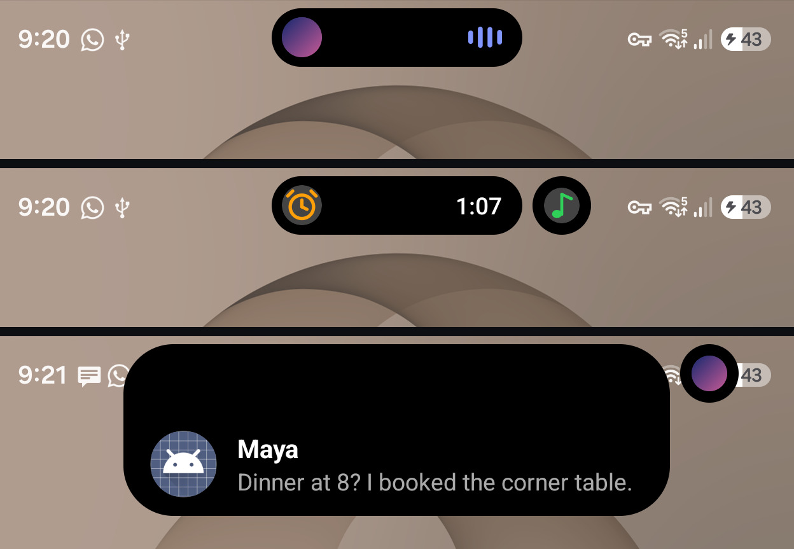
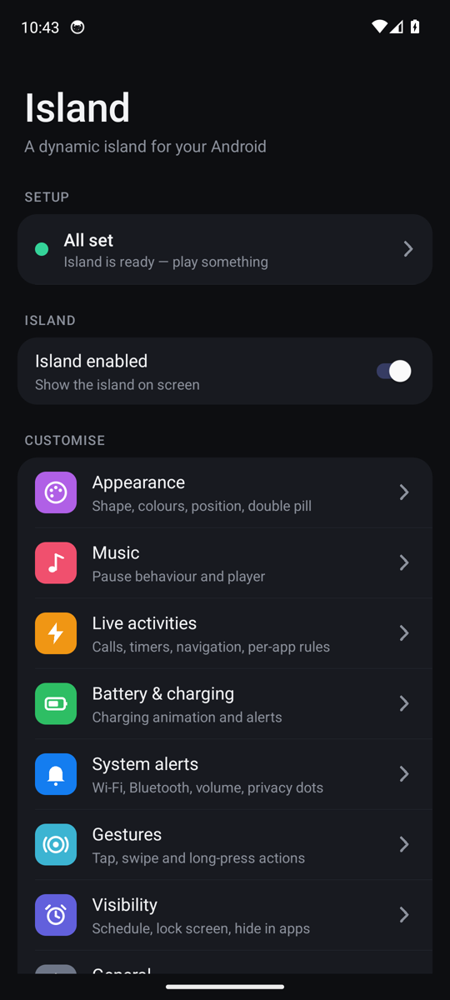
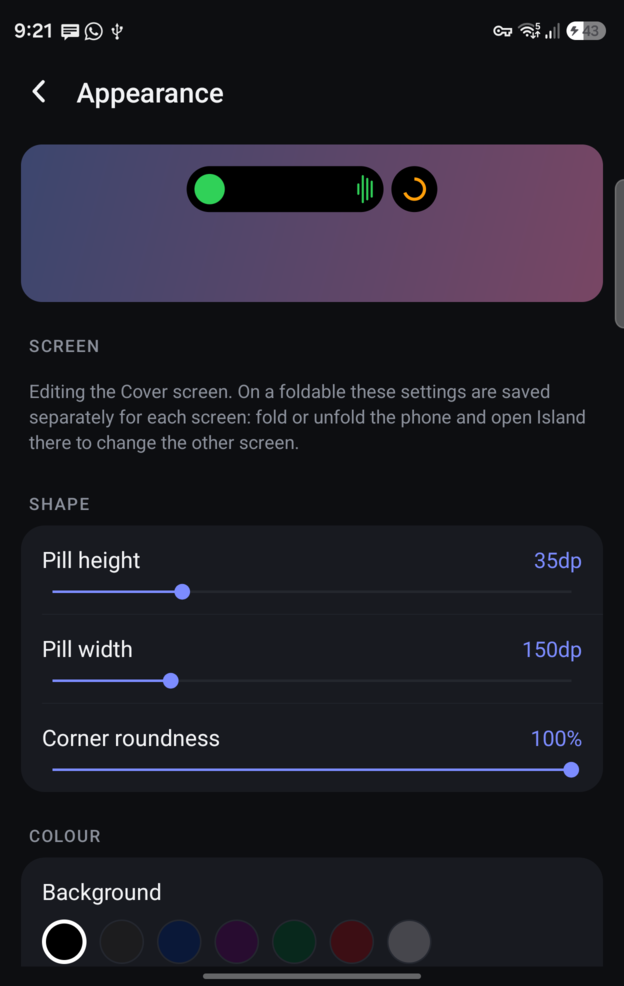
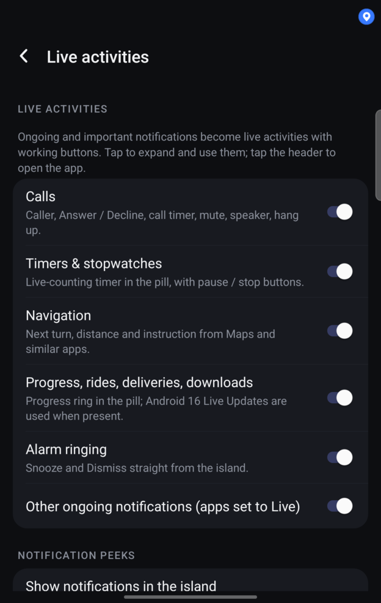
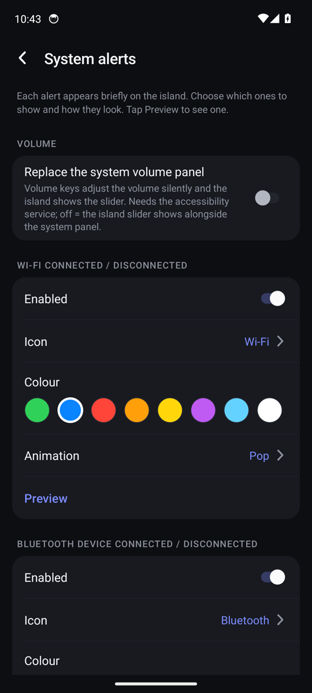
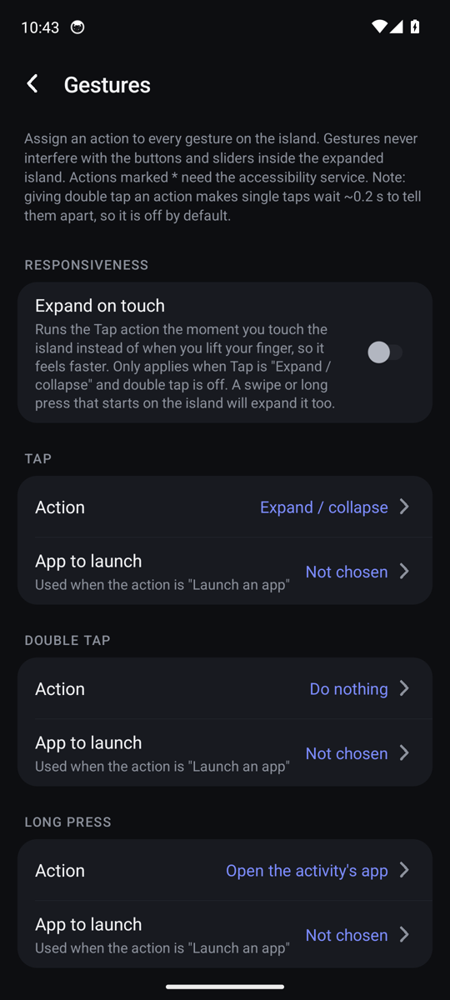
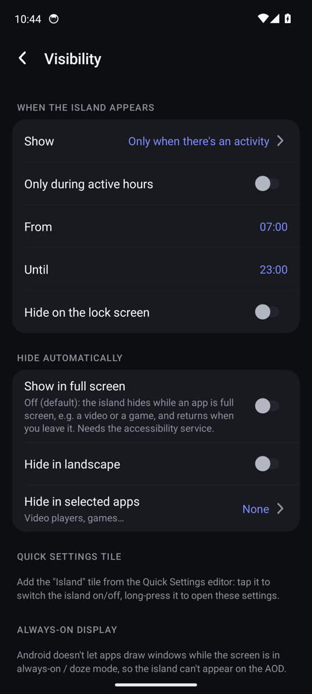
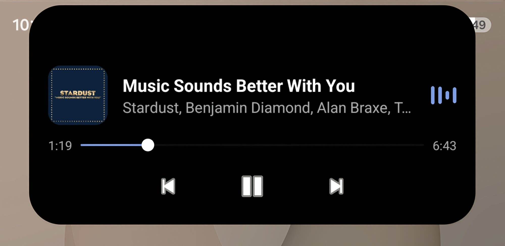

<div align="center">

# Orbit: Camera Island

**A camera island for Android.**
A small black pill around your front camera that shows what's happening on your phone: music, calls, timers, navigation, charging, system alerts and notifications. Tap it to expand, swipe it, and make it yours.


> **Not available for download yet.** A Google Play release is planned. Until then you can read the code and build it yourself (see [Building](#building-from-source)).



</div>

---

## Highlights

- **It finds your camera.** Orbit detects where the front camera is on each screen, including **under-display cameras on foldables**, and centres itself on it. Foldables keep separate settings for each screen.
- **Live activities with working buttons.** Calls (Answer / Decline, timer, mute, speaker, hang up), timers and stopwatches, navigation, downloads and deliveries, alarms ringing. Notifications peek out and can be answered inline.
- **Two things at once.** When two activities are live, a second small pill splits off beside the first. Tap it and the pills trade places.
- **Fluid animations.** The island drops into the camera and comes back out like a water drop, expands on a soft spring, and swaps pills in three beats.
- **Private by design.** The app **never asks for the internet permission**. Nothing leaves your phone, and there is no analytics.
- **Highly configurable.** Every gesture, every alert's icon / colour / animation, the shape and colour of the pill, schedules, per-app rules, and more.

## What it shows

| | |
|---|---|
| 🎵 **Music** | Album art, equalizer, expandable player with a draggable seek bar. Closes itself after a pause of your choosing. |
| 📞 **Calls** | Caller, Answer and Decline, running call timer, mute / speaker / hang up. |
| ⏱ **Timers & stopwatch** | A live count in the pill. Works with the standard Clock apps and Samsung's Clock. |
| 🧭 **Navigation** | Distance to the next turn in the pill, full instruction when expanded. |
| 🔋 **Battery** | Charging animation (fast / wireless, time to full), unplug, low, critical and full-charge alerts. |
| 🔔 **System alerts** | Wi-Fi, Bluetooth (with device name), hotspot, VPN, next alarm, volume slider, ringer mode, Do Not Disturb, plus airplane mode, NFC, mobile data, flashlight. Each with its own icon, colour and animation. |
| 🔴 **Privacy dots** | Microphone, camera and screen recording indicators. |
| 💬 **Notifications** | Short peeks with action buttons and inline reply. Choose per app: peek, live, or off. |

## Screenshots

<table>
  <tr>
    <td></td>
    <td></td>
    <td></td>
  </tr>
  <tr>
    <td></td>
    <td></td>
    <td></td>
  </tr>
</table>

<div align="center">
<br>
<sub>Expanded music player: seek, skip and pause right from the island. Content sits below the camera cut-out.</sub>
</div>

## Gestures

Tap, double tap, long press and swipes in four directions can each be assigned any action: expand or collapse, open the app, play / pause / next / previous, home, recents, back, screenshot, lock screen, open the notification shade or Quick Settings, toggle the flashlight, launch any app, or do nothing. There is also an optional **expand on touch** mode for a snappier feel. When the island has nothing to show you can also assign an action to **tapping the camera itself** (an invisible target sits over it), for example play / pause, the flashlight or a screenshot.

## Everyday controls

Show the island only when something is happening (or always), set active hours, hide it on the lock screen, hide it in chosen apps, **hide it automatically in full-screen apps** (video, games), hide it while the notification panel or Quick Settings is open, and add a Quick Settings tile to switch it on and off.

## Requirements and compatibility

- Android **8.0 (API 26) or newer**. Built against API 35.
- Developed and tested on a **Samsung foldable (SM-F971B)**, both its inner and cover screens, and lightly on an Android 14 emulator.
- Detecting a hidden camera and some of the hiding behaviour depend on how a phone's system UI reports itself. Behaviour on **Pixel and other phones has not been verified yet**. If you try it on one, please [open an issue](../../issues/new/choose) and say what worked.

## Permissions

| Permission | Why |
|---|---|
| Notification access | Reads media sessions, notifications, calls, timers and progress so they can be shown. Processed on the device only. |
| Accessibility service | Draws the island above the status bar, performs gestures such as home and screenshot, knows which app is in front, and lists the on-screen windows to detect the notification panel and full-screen apps. It declares the window-content capability only because Android requires it to list windows. It never reads what is on your screen. |
| Display over other apps | Fallback overlay when the accessibility service is off. |
| Battery optimisation exemption | Keeps Android from stopping the island in the background. |
| Bluetooth, Location, Phone *(optional)* | Bluetooth device names, the Wi-Fi network name (Android requires location for it, and Orbit never reads your location), and answering or ending calls through Android as a fallback. |

There is **no internet permission**. See the full list in [`AndroidManifest.xml`](app/src/main/AndroidManifest.xml).

On Android 13 and newer, an app installed outside the Play Store needs **"Allow restricted settings"** (App info → ⋮ menu) before the accessibility service and notification access can be switched on. The setup checklist inside the app walks through it.

## How it works

```
 NotificationListenerService ──┐                      ┌── MediaProvider       (music)
                               ├─►  IslandController ─┼── NotificationEngine  (calls, timers, nav, peeks)
 AccessibilityService ─────────┘   (priorities, rules)├── BatteryProvider
   · overlay window                      │            └── SystemAlerts        (Wi-Fi, BT, volume, ...)
   · window list (panel / full screen)   ▼
   · global gestures              IslandOverlay  ──►  pills, banners, expanded views, animations
```

- **`IslandController`** keeps a priority-ordered list of *activities*, decides which is the main pill and which is the small one, and applies the visibility rules.
- **Providers** turn Android signals into activities. Nothing polls: everything is callback-driven.
- **`IslandOverlay`** owns the window and all of the animation.
- **`CameraLocator`** reads the system cut-out, or the under-display-camera shape from the framework resources when the system reports none.
- No third-party libraries: the Android framework and Kotlin only.

| Path | What it does |
|---|---|
| `island/` | Controller, overlay, content views, icons, camera locator |
| `activities/` | Media, notification engine and builders, battery |
| `alerts/` | System alert detection and per-alert styling |
| `gestures/` | Touch handling and gesture actions |
| `settings/` | The settings app, per-screen preferences |
| `src/debug/` | Debug-only test hook (not in release builds) |

## Building from source

You need JDK 17 and the Android SDK (platform 35, build-tools 35.0.0).

```bash
git clone https://github.com/BallbeIan/orbit-camera-island.git
cd orbit-camera-island
export ANDROID_HOME=~/Android/Sdk
./gradlew assembleDebug        # app/build/outputs/apk/debug/app-debug.apk
./gradlew lint
```

Or open the folder in Android Studio and run it on a device.

## Contributing

Bug reports and device reports are very welcome. See [CONTRIBUTING.md](CONTRIBUTING.md).

## License

Orbit is **source-available** under the [PolyForm Noncommercial License 1.0.0](LICENSE). You may read, learn from, modify and build it for personal and other noncommercial use. **Commercial use, including selling or publishing it on an app store, is not permitted without the author's permission.** A paid Google Play version is planned by the author.

## Disclaimer

Orbit is an independent project. It is not affiliated with, endorsed by, or sponsored by Apple Inc. "Dynamic Orbit" is a trademark of Apple Inc.
